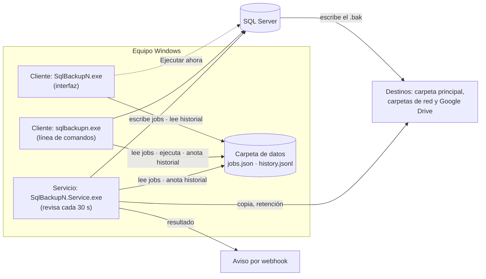

# SQL Backup N

**Backups de SQL Server programados, automáticos y en segundo plano, para servidores y PC con Windows.**
Software libre (MIT) de **Centinela Appliance**.

## Qué hace

- **Varios servidores y varias bases de datos** por job: todas las de usuario (incluidas las nuevas), las que **elija de una lista leída del servidor** (tras probar la conexión), o un patrón como `Ventas*`.
- **Backups completo, diferencial y de log de transacciones**, combinables en un mismo plan (p. ej. completo el domingo, diferencial cada noche, log cada 15 minutos). La **programación es visual**: se elige la frecuencia en una lista, la hora y los minutos con selectores y los días con botones, sin escribir expresiones cron.
- **Segundo plano real**: un servicio de Windows ejecuta la programación aunque nadie haya iniciado sesión; recupera ejecuciones perdidas si el equipo estuvo apagado.
- **Destinos**: carpeta local, unidad o ruta de red, y **Google Drive mediante su API oficial** (sin depender de la unidad `G:\` ni de una sesión de usuario; las credenciales de Google se piden **una sola vez** con pasos guiados). El primero lo escribe SQL Server; los demás son copias (regla 3-2-1). Ver [Google Drive](docs/google-drive.md).
- **Retención** por antigüedad y/o cantidad, con una regla de seguridad: nunca borra el backup más reciente.
- **Verificación** automática (`RESTORE VERIFYONLY` + `CHECKSUM`) tras cada backup.
- **Avisos** por webhook (Teams, Slack u otros) cuando algo falla.
- **Interfaz gráfica de administración**: crear, editar, duplicar y eliminar jobs sin tocar archivos, con **validación en vivo** de cada dato (errores junto al campo, resumen por pestaña y advertencias de buenas prácticas), pruebas de **conexión** y de **escritura en destinos**, y vista previa de las próximas ejecuciones.
- **Línea de comandos** pensada para scripts, con salida JSON y códigos de salida definidos.

## Cómo funciona

La interfaz y la línea de comandos (el **cliente**) y el **servicio** de Windows no se comunican entre sí: se coordinan por una
carpeta de datos compartida. El cliente guarda los jobs; el servicio los lee cada 30 s, ejecuta la programación y anota el historial.



Cómo instalarlo, por ejemplo en `C:\SqlBackupN` con su carpeta de datos: [Instalación y funcionamiento](docs/deployment.md).

## Capturas

Las imágenes usan **datos ficticios de demostración**. Se regeneran con
`tools/Capture-Screenshots.ps1` (compile antes la solución).

**Panel principal** — lista de jobs con su último estado, configuración en tarjetas, historial (se puede borrar una ejecución, todo el historial de un job o el de todos) y, al ejecutar, el registro paso a paso. El botón «Tema» de la barra lateral cambia entre modo automático, claro y oscuro:


**Bienvenida** — sin jobs, la aplicación guía hacia el primero:


**Job con advertencia** (falló la copia a un destino secundario) y **job con fallo** (el motivo se ve en el historial):


### Editor de jobs

Todas las opciones del job se administran desde el editor, organizadas por pestañas:


**Validación en vivo** — cada dato se comprueba mientras se escribe. Lo que *falta* por rellenar se muestra en tono neutro («Faltan 2 datos para poder guardar») y solo lo *incorrecto* sale en rojo; el resumen indica en qué pestaña está cada cosa (también al abrir un `jobs.json` escrito a mano):


**Destino Google Drive** — credenciales de su proyecto de Google Cloud, conexión de la cuenta con un clic (autorización una sola vez en el navegador) y carpeta de destino; el servicio sube después una copia por HTTPS:


## Componentes

| Proyecto | Qué es |
|---|---|
| `SqlBackupN.Core` | Lógica de negocio (sin interfaz): dominio, planificación, ejecución, retención |
| `SqlBackupN.Service` | Servicio de Windows que ejecuta la programación |
| `SqlBackupN.Presentation` | View-models (MVVM) sin dependencia de WPF: lista de jobs y editor con validación |
| `SqlBackupN.App` | Interfaz gráfica (WPF): ventanas, estilos y diálogos |
| `SqlBackupN.Cli` | Comando `sqlbackupn` |
| `SqlBackupN.Tests` | Pruebas automáticas (xUnit) |

## Requisitos

- Windows 10/11 o Windows Server 2016+.
- .NET 9 SDK para compilar (el tiempo de ejecución para usar los binarios).
- SQL Server 2012 o superior (incluye Express).

## Compilar y probar

```bash
dotnet build SqlBackupN.sln
dotnet test SqlBackupN.sln
```

## Primeros pasos

1. Abra la interfaz (`dotnet run --project src/SqlBackupN.App`) y pulse **+ Nuevo** para crear el primer job:
   servidor, bases de datos, programación, destinos, opciones, retención y avisos. Los jobs se guardan en
   `%ProgramData%\Centinela\SqlBackupN\jobs.json`; también puede escribirlo a mano a partir de
   `samples/jobs.example.json` (ver [configuración](docs/configuration.md)).
2. Pruebe desde la línea de comandos:

   ```bash
   dotnet run --project src/SqlBackupN.Cli -- jobs
   dotnet run --project src/SqlBackupN.Cli -- run "Ventas nocturno" --type full
   ```

   Mientras corre, `run` escribe cada paso en el error estándar; la interfaz lo muestra en una ventana aparte («Registro de ejecución»)
   y cada ejecución del historial conserva el suyo (haga clic en ella para abrirlo).

3. Instale el servicio (PowerShell como administrador), apuntando al ejecutable publicado:

   ```powershell
   dotnet publish src/SqlBackupN.Service -c Release -o C:\SqlBackupN
   sc.exe create SqlBackupN binPath= "C:\SqlBackupN\SqlBackupN.Service.exe" start= auto
   sc.exe start SqlBackupN
   ```

   La cuenta del servicio necesita el rol `db_backupoperator` (o `sysadmin`) en SQL Server y permiso de
   escritura en los destinos.

   El diagrama de cómo se coordinan el cliente y el servicio, y la instalación completa en `C:\SqlBackupN` con su carpeta de datos, están en [Instalación y funcionamiento](docs/deployment.md).

## Documentación

- [Instalación y funcionamiento del cliente y el servicio](docs/deployment.md)
- [Arquitectura](docs/architecture.md)
- [Reglas de desarrollo](docs/rules.md)
- [Configuración de jobs](docs/configuration.md)
- [Enviar los backups a Google Drive](docs/google-drive.md)
- [Reglas de validación](docs/validation.md)
- [Sistema de diseño de la interfaz](docs/design.md)
- [Hoja de ruta](docs/roadmap.md)
- [Contribuciones](CONTRIBUTING.md) · [Seguridad](SECURITY.md) · [Cambios](CHANGELOG.md)

## Estado

Versión **0.4** (núcleo, servicio, CLI, administración completa de jobs desde la interfaz, programación visual y copias a Google Drive). El destino de Google Drive se probó con dobles de prueba; la integración real con Google debe validarse con su propia cuenta (ver [guía](docs/google-drive.md)). El asistente de restauración y los avisos por correo están en la [hoja de ruta](docs/roadmap.md).

## Licencia

[MIT](LICENSE) © 2026 Centinela Appliance
