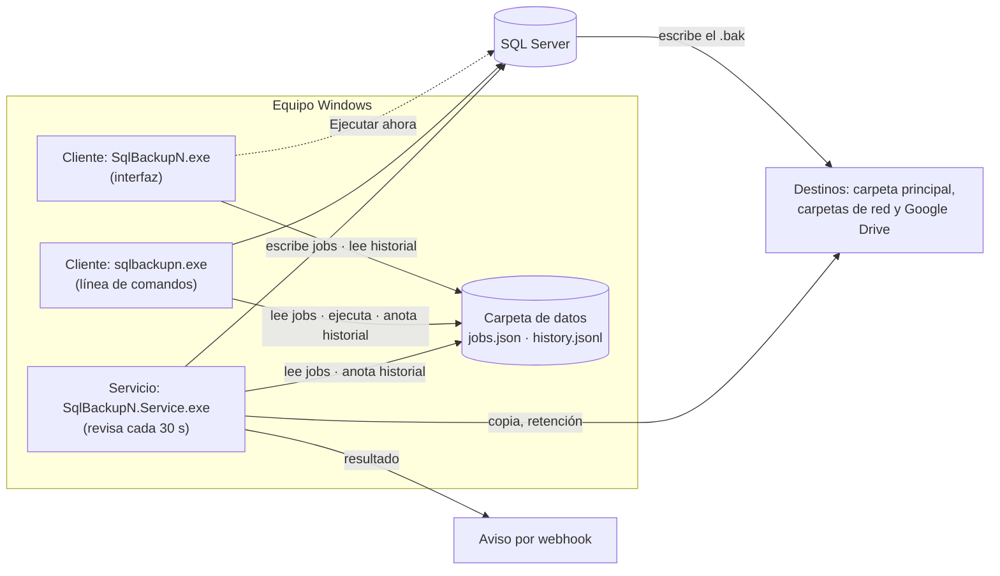
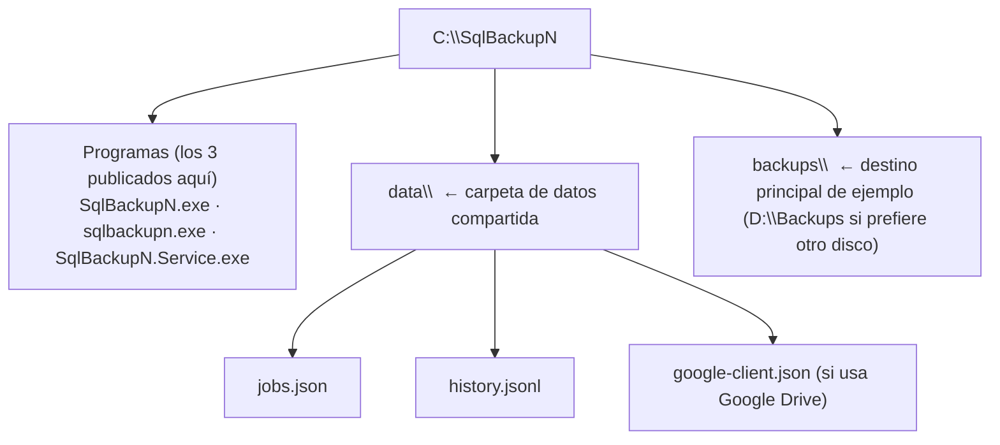

# Cómo funcionan el cliente y el servicio, e instalación en `C:\SqlBackupN`

SQL Backup N tiene tres programas que **no se hablan entre sí**: se coordinan solo a través de una **carpeta de datos**
compartida (`jobs.json` e `history.jsonl`). Por eso, todo lo que hay que configurar al instalar es *dónde están los
programas* y *que los tres usen la misma carpeta de datos*.

## Quién hace qué

| Programa | Función | Cuándo corre |
|---|---|---|
| **Cliente** `SqlBackupN.exe` (interfaz) | Crea y edita jobs, muestra el historial, ejecuta un job a mano | Cuando alguien lo abre |
| **Cliente** `sqlbackupn.exe` (línea de comandos) | Lo mismo desde scripts: `jobs`, `run "<job>"` | Cuando se invoca |
| **Servicio** `SqlBackupN.Service.exe` | Ejecuta la programación: cada 30 s revisa qué pasos de qué jobs tocan y los lanza | Siempre, aunque nadie haya iniciado sesión |

El cliente **no ejecuta la programación** y el servicio **no tiene pantalla**: el cliente solo escribe `jobs.json`; el servicio
lo vuelve a leer en cada ciclo (30 s), así que no hace falta reiniciarlo al guardar un cambio.



Puntos que conviene recordar:

- **Quien escribe el backup es SQL Server**, no la aplicación. La ruta del destino principal debe existir *para el servidor SQL*
  y la cuenta del servicio de SQL Server debe poder escribir en ella.
- La aplicación (cliente o servicio) se conecta a SQL Server con la cuenta de Windows con la que corre, o con el usuario SQL del job.
- El historial se escribe **añadiendo líneas**, por eso cliente y servicio pueden escribir a la vez sin pisarse.

## Instalación en `C:\SqlBackupN`

Estructura recomendada (todo en una carpeta, fácil de copiar o de respaldar):



### 1. Publicar los programas

En PowerShell como administrador, desde la carpeta del repositorio:

```powershell
dotnet publish src/SqlBackupN.Service -c Release -o C:\SqlBackupN
dotnet publish src/SqlBackupN.App     -c Release -o C:\SqlBackupN
dotnet publish src/SqlBackupN.Cli     -c Release -o C:\SqlBackupN
New-Item -ItemType Directory C:\SqlBackupN\data -Force
```

### 2. Indicar la carpeta de datos (la regla que más importa)

Sin configurar nada, los tres programas usan `%ProgramData%\Centinela\SqlBackupN`. Para usar `C:\SqlBackupN\data`
defina la variable `SQLBACKUPN_DATA` **a nivel de equipo**, de modo que la vean el servicio y los clientes de cualquier usuario:

```powershell
[Environment]::SetEnvironmentVariable("SQLBACKUPN_DATA", "C:\SqlBackupN\data", "Machine")
```

> Una variable de equipo solo la reciben los programas que se **inician después**: reinicie el servicio
> (`Restart-Service SqlBackupN`) y cierre y vuelva a abrir la interfaz y las consolas. Si el cliente y el servicio usan
> carpetas distintas, el cliente guardará jobs que el servicio nunca verá.

### 3. Permisos de la carpeta de datos

| Quién | Qué necesita sobre `C:\SqlBackupN\data` |
|---|---|
| Personas que usan la interfaz | Modificar (para guardar `jobs.json`) |
| Cuenta del servicio | Leer `jobs.json`; escribir `history.jsonl` |

```powershell
icacls C:\SqlBackupN\data /grant "BUILTIN\Users:(OI)(CI)M"
```

Ajuste `Users` a un grupo más restringido si el equipo es compartido.

### 4. Instalar y arrancar el servicio

```powershell
sc.exe create SqlBackupN binPath= "C:\SqlBackupN\SqlBackupN.Service.exe" start= auto
sc.exe start SqlBackupN
```

Por defecto corre como `LocalSystem`. Si usa **autenticación de Windows** hacia SQL Server, esa cuenta (o la que elija con
`obj= "DOMINIO\cuenta"` y `password=`) necesita el rol `db_backupoperator` (o `sysadmin`) en SQL Server, y permiso de
escritura en las carpetas de copia (por ejemplo una carpeta de red).

### 5. Comprobar

```powershell
C:\SqlBackupN\sqlbackupn.exe jobs                      # debe listar los jobs de C:\SqlBackupN\data
Get-Content C:\SqlBackupN\data\history.jsonl -Tail 3   # el servicio anota aquí cada ejecución
```

## Qué es de cada usuario y qué es de la máquina

| Dato | Dónde | Compartido |
|---|---|---|
| Jobs e historial | Carpeta de datos (`SQLBACKUPN_DATA`) | Sí: servicio, CLI e interfaz |
| Credenciales de Google compartidas | `google-client.json` en la carpeta de datos, o junto al ejecutable (`C:\SqlBackupN`) | Sí |
| Tema claro/oscuro de la interfaz | `%LocalAppData%\Centinela\SqlBackupN\settings.json` | No: cada usuario de Windows |
| Contraseñas SQL y tokens | Dentro de `jobs.json`, cifrados con DPAPI del **equipo** | Solo en ese equipo: no se pueden copiar a otro |

Para pasar la instalación a otro equipo copie `C:\SqlBackupN`, pero **vuelva a escribir las contraseñas** en el editor de jobs
(el cifrado de equipo no es portable) y reconecte Google Drive.
